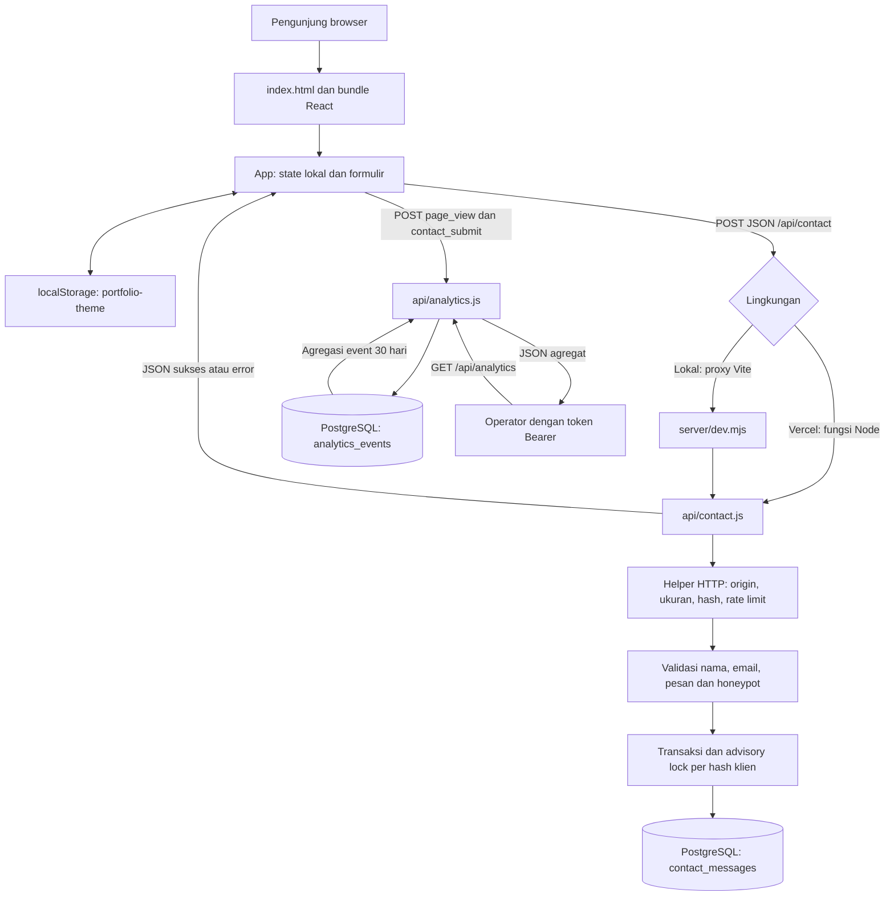

# Arsitektur aplikasi

Dokumen ini menjelaskan kode yang tersedia di repositori, bukan konfigurasi layanan eksternal yang sudah terpasang. Aplikasi merupakan satu halaman React yang dibangun Vite, dengan dua handler API Node.js dan PostgreSQL. Tidak ada router sisi klien, framework backend, ORM, CMS, maupun layanan pengiriman email.

## Batas modul

| Modul | Tanggung jawab | Batas dan dependensi |
| --- | --- | --- |
| `index.html`, `src/main.jsx` | Metadata dokumen, memuat font, memasang React pada `#root` dalam `StrictMode` | Titik masuk browser; tidak membaca rahasia server |
| `src/App.jsx` | Navigasi anchor, tema, konten profil, kartu proyek dan dialog, formulir kontak, status pengiriman | State lokal melalui hooks; proyek berupa array statis dan ditandai placeholder; belum dipisah menjadi modul fitur |
| `Reveal` dalam `src/App.jsx` | Animasi kemunculan konten | Framer Motion; menghormati preferensi reduced motion |
| `src/styles.css` | Layout, tampilan responsif, tema dan ilustrasi CSS | Dipakai seluruh halaman; bukan CSS Modules |
| `api/contact.js` | Validasi kontak, honeypot, kuota dan penyimpanan pesan | Menggunakan helper HTTP serta transaksi PostgreSQL; tidak mengirim email |
| `api/analytics.js` | Menerima event terbatas dan mengembalikan agregasi 30 hari untuk admin | GET membutuhkan token Bearer; POST tidak membutuhkan akun |
| `server/http.js` | Respons JSON, pembatasan metode/origin/body, hash klien, rate limit dan autentikasi admin | Helper bersama; penghitung rate limit tersimpan dalam memori instance |
| `server/db.js` | Membuat dan menggunakan ulang connection pool PostgreSQL | `pg`, `DATABASE_URL`; maksimum tiga koneksi per instance |
| `server/dev.mjs` | Memetakan URL ke handler saat pengembangan lokal | HTTP bawaan Node; hanya mendengarkan pada `127.0.0.1`, port standar 3001 |
| `server/schema.sql` | DDL tabel dan indeks | Diterapkan operator secara eksplisit; tidak dijalankan oleh request |

Tema disimpan pada `localStorage` dengan kunci `portfolio-theme`. State menu, proyek aktif, nilai formulir, serta status pengiriman hanya hidup di browser. GSAP mengendalikan ilustrasi hero dan membersihkan animasi melalui context saat efek dilepas. Dialog proyek memakai elemen HTML `dialog`.

## Struktur direktori

```text
.
├── index.html                 # Dokumen dan entry frontend
├── src/
│   ├── main.jsx               # Mount React dan impor stylesheet
│   ├── App.jsx                # Halaman, Reveal, state dan fetch kontak
│   └── styles.css             # Desain dan responsivitas
├── api/
│   ├── contact.js             # POST /api/contact
│   └── analytics.js           # GET dan POST /api/analytics
├── server/
│   ├── db.js                  # Pool PostgreSQL
│   ├── http.js                # Helper protokol dan kontrol request
│   ├── dev.mjs                # Server API lokal
│   ├── schema.sql             # Tabel contact_messages dan analytics_events
│   ├── api.test.js            # Pengujian API dengan node:test
│   └── README.md              # Petunjuk operasi API
├── docs/                      # Dokumentasi proyek
├── .github/workflows/         # CI
├── .env.example               # Nama konfigurasi server tanpa nilai rahasia
├── vite.config.js             # Plugin React dan proxy /api lokal
├── eslint.config.js           # Pemeriksaan JavaScript dan hooks
├── package.json
└── package-lock.json          # Versi dependency yang dikunci
```

`dist/` dihasilkan oleh build dan tidak menjadi sumber aplikasi. `node_modules/` dihasilkan oleh instalasi dependency.

## Versi teknologi

Versi berikut berasal dari `package-lock.json`; deklarasi pada `package.json` menggunakan rentang caret (`^`). Gunakan `npm ci` untuk memasang versi yang dikunci. CI memakai Node.js 22; versi server PostgreSQL belum ditentukan oleh repositori.

| Dependency | Versi terkunci | Peran |
| --- | --- | --- |
| react / react-dom | 19.3.1 / 19.3.1 | UI dan renderer browser |
| framer-motion | 14.10.1 | Animasi reveal dan deteksi reduced motion |
| gsap | 3.15.1 | Animasi ilustrasi hero |
| lucide-react | 1.70.0 | Ikon React |
| pg | 8.23.1 | Driver PostgreSQL server |
| vite | 8.3.6 | Dev server dan build frontend |
| @vitejs/plugin-react | 6.2.1 | Integrasi React pada Vite |
| eslint / @eslint/js | 10.14.0 / 10.0.1 | Pemeriksaan statis |
| eslint-plugin-react-hooks | 7.1.1 | Aturan hooks |
| eslint-plugin-react-refresh | 0.5.7 | Plugin tersedia pada konfigurasi ESLint |
| globals | 17.14.0 | Definisi global browser dan Node |

## Aliran data



Pada kontak, browser mengirim JSON ke URL relatif `/api/contact`. Handler memeriksa metode, origin dan kuota memori sebelum membaca body maksimal 8 KiB. Setelah validasi, transaksi mengambil advisory lock PostgreSQL berdasarkan hash klien, menghitung pesan sepuluh menit terakhir, lalu menyimpan pesan jika belum mencapai lima. SQL menggunakan parameter. Respons sukses baru dikirim setelah commit; UI menampilkan status dan mengosongkan formulir.

Analytics menerima `page_view` atau `contact_submit` serta path yang dibatasi. Penyimpanan event tidak mencakup IP, user agent, cookie atau identitas pengunjung. GET hanya memberikan hitungan per jenis event selama 30 hari, bukan daftar event mentah. Hash IP dengan salt digunakan pada kuota kontak; hash tersebut tetap merupakan data tersimpan pada tabel kontak.

## Alasan pemilihan dan konsekuensi

- React dengan Vite mendukung satu halaman interaktif dengan proses build sederhana. Navigasi anchor sesuai struktur halaman saat ini; perubahan menjadi banyak halaman memerlukan keputusan routing baru.
- State lokal cukup untuk tema, modal dan formulir. Belum ada kebutuhan penyimpanan global atau manajemen state tambahan.
- Framer Motion menangani animasi berbasis tampilan, sementara GSAP menangani ilustrasi hero. Pembagian ini praktis tetapi membawa dua library animasi yang perlu dipelihara dan dievaluasi terhadap ukuran bundle.
- Handler Node berbentuk fungsi dapat dipakai ulang oleh server lokal dan deployment Vercel. Proxy Vite mempertahankan URL relatif yang sama selama pengembangan.
- PostgreSQL menyimpan pesan secara persisten dan menyediakan transaksi serta lock untuk kuota lintas instance. Pool kecil membatasi koneksi per instance, tetapi jumlah total koneksi tetap tumbuh bersama jumlah instance serverless.
- Helper HTTP bersama menghindari duplikasi kontrol request. Token admin hanya dikonsumsi server dan tidak boleh memakai prefiks `VITE_`.

## Batas implementasi dan operasional

Konten proyek saat ini adalah placeholder statis, bukan proyek yang diambil dari database. Tidak ada panel admin, inbox publik, login pengguna, unggahan berkas, notifikasi email atau integrasi LinkedIn API; tautan LinkedIn hanya membuka profil eksternal. Font dimuat dari Google Fonts sehingga membutuhkan akses jaringan browser ke layanan tersebut.

Frontend mengirim `page_view` saat mount serta `contact_submit` setelah respons kontak sukses, menggunakan `window.location.pathname`. Pengiriman analytics bersifat best effort: kegagalannya tidak menghalangi formulir dan tidak ditampilkan kepada pengunjung. Event bukan pengukuran pengunjung unik; `StrictMode` saat pengembangan dapat menjalankan efek mount lebih dari sekali. Formulir menggunakan honeypot `company` dan batas pesan 4.000 karakter yang sesuai dengan kontrak API; validasi server tetap menjadi acuan.

Rate limit analytics berbasis memori tidak terdistribusi dan hilang saat instance berhenti. Kontak menambahkan kuota database lintas instance; pengunjung di jaringan/IP bersama dapat berbagi kuota. Pemeriksaan origin mengizinkan klien tanpa header Origin dan bukan autentikasi. Honeypot tidak menjamin pemblokiran bot.

Skema database diterapkan manual; belum ada runner migrasi berversi, pekerjaan retensi terjadwal atau prosedur backup otomatis dalam kode. Konfigurasi Vercel, database produksi, TLS, secret, proteksi branch dan deployment nyata berada di luar repositori. CI menjalankan lint, pengujian Node dan build; CI tidak otomatis menggabungkan PR atau membuktikan layanan produksi sudah dikonfigurasi.
